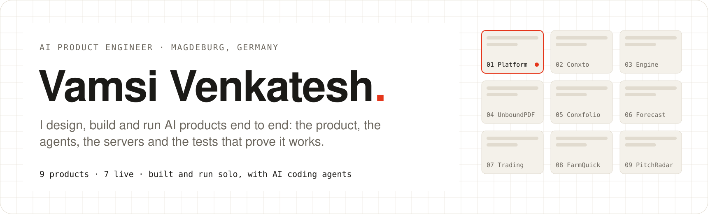
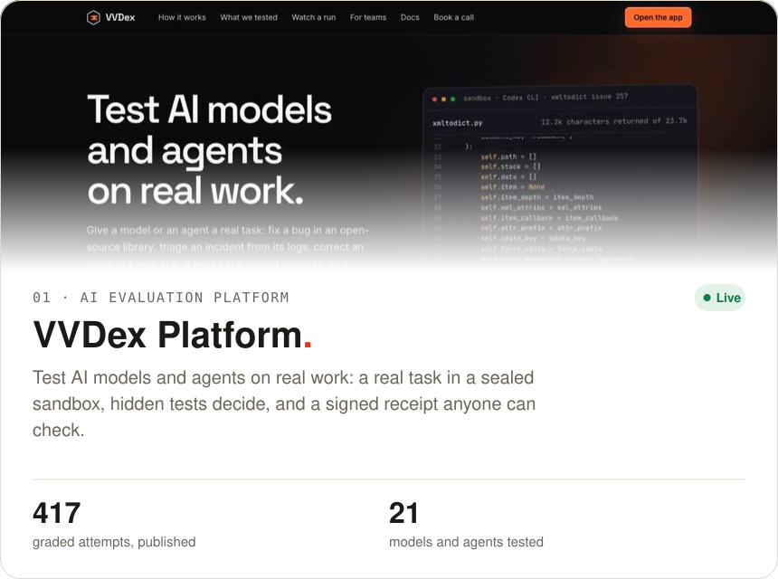
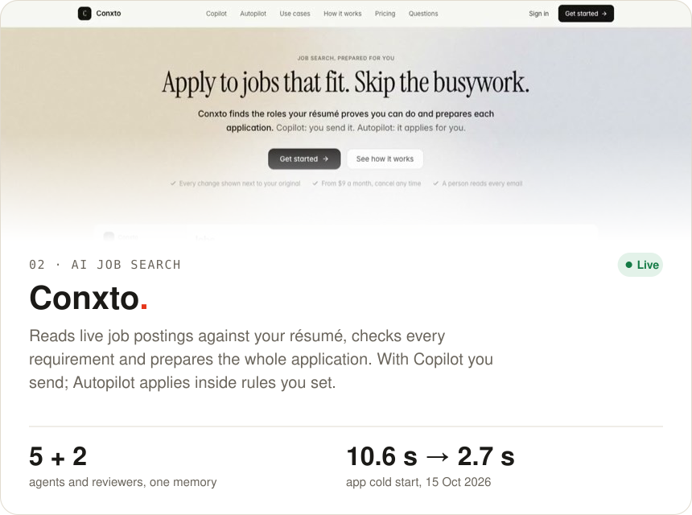
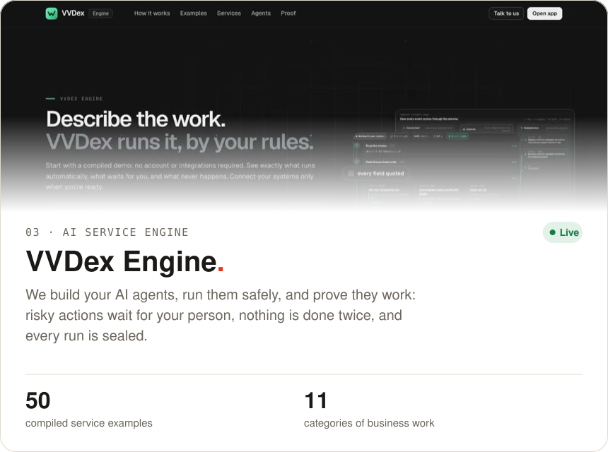
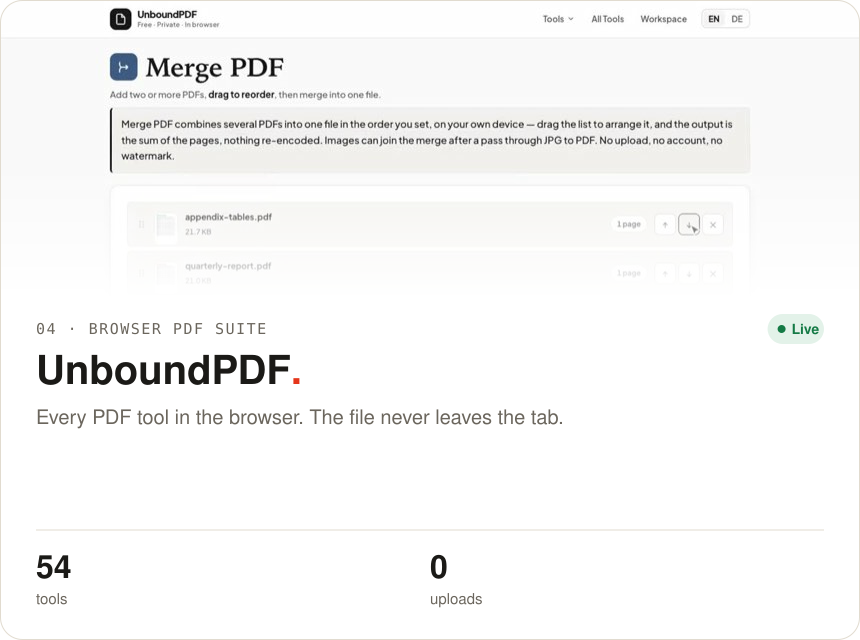
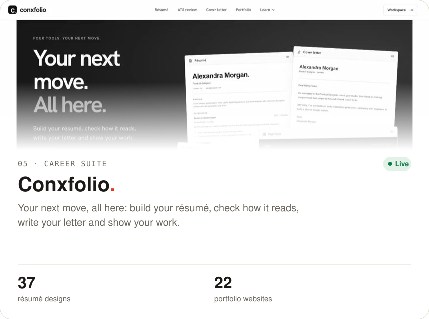
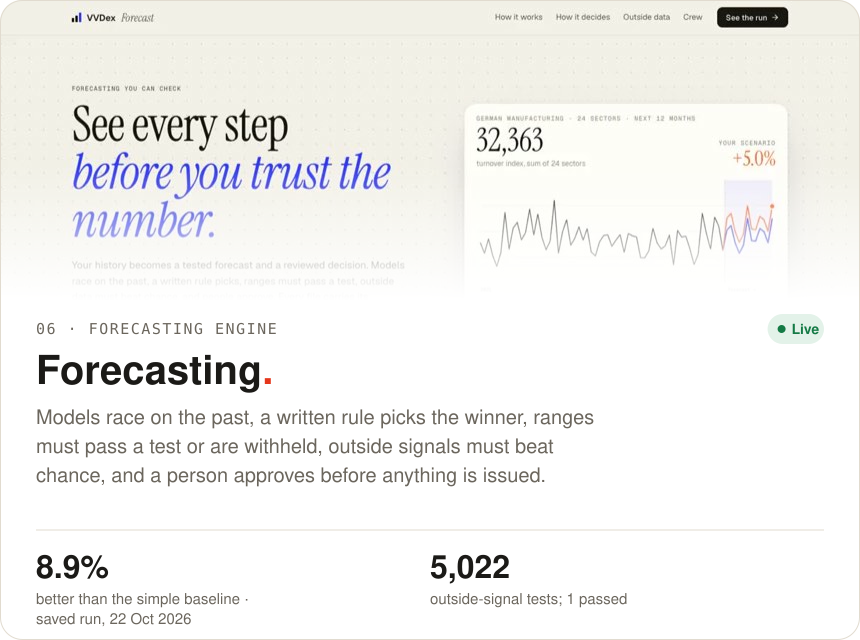
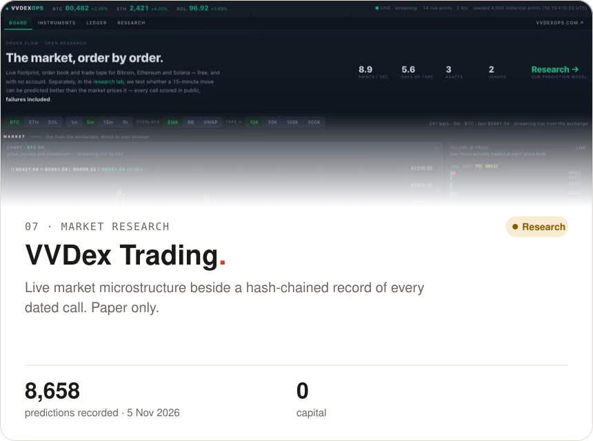
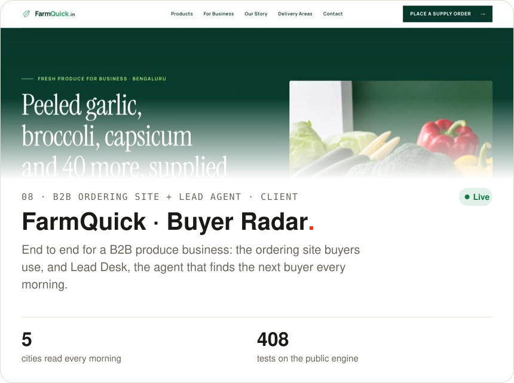
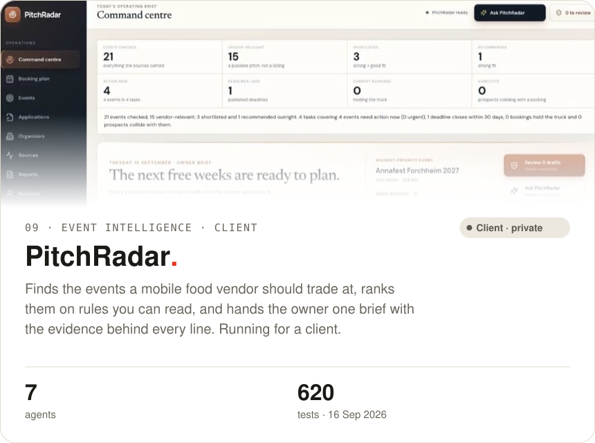

<a href="https://vamsivenkatesh.com/"><picture><source media="(prefers-color-scheme: dark)" srcset="assets/header-dark.svg"></picture></a>

<a href="https://vamsivenkatesh.com/"><b>Portfolio</b></a> ·
<a href="https://vamsi-venkatesh.github.io/portfolio-designs/"><b>14 portfolio designs</b></a> ·
<a href="https://www.linkedin.com/in/vamsivenkatesh">LinkedIn</a> ·
<a href="mailto:vamsi@vamsivenkatesh.com">vamsi@vamsivenkatesh.com</a> ·
<a href="https://vvdexops.com/book">Book a call</a>

## Products

Seven products I build and run myself, each live on the web. Numbers are as of 5 November 2026 unless a card gives its own date.

<table>
<tr><td width="50%" valign="top"><a href="https://vvdexops.com/"><picture><source media="(prefers-color-scheme: dark)" srcset="assets/vvdex-platform-dark.svg"></picture></a> <a href="https://vvdexops.com/">Open</a> · <a href="https://vvdexops.com/evals">Results</a> · <a href="https://github.com/vamsi-venkatesh/vvdex-forge-proof">Proof</a> · <a href="https://github.com/vamsi-venkatesh/evalhub">Eval Hub code</a></td><td width="50%" valign="top"><a href="https://conxto.com/"><picture><source media="(prefers-color-scheme: dark)" srcset="assets/conxto-dark.svg"></picture></a> <a href="https://conxto.com/">Open</a> · <a href="https://github.com/vamsi-venkatesh/conxto">About</a></td></tr>
<tr><td width="50%" valign="top"><a href="https://lab.vvdexops.com/"><picture><source media="(prefers-color-scheme: dark)" srcset="assets/vvdex-engine-dark.svg"></picture></a> <a href="https://lab.vvdexops.com/">Open</a></td><td width="50%" valign="top"><a href="https://unboundpdf.com/"><picture><source media="(prefers-color-scheme: dark)" srcset="assets/unboundpdf-dark.svg"></picture></a> <a href="https://unboundpdf.com/">Open</a> · <a href="https://github.com/vamsi-venkatesh/unboundpdf">Code</a></td></tr>
<tr><td width="50%" valign="top"><a href="https://conxfolio.com/"><picture><source media="(prefers-color-scheme: dark)" srcset="assets/conxfolio-dark.svg"></picture></a> <a href="https://conxfolio.com/">Open</a></td><td width="50%" valign="top"><a href="https://lab.vvdexops.com/forecast/"><picture><source media="(prefers-color-scheme: dark)" srcset="assets/forecasting-dark.svg"></picture></a> <a href="https://lab.vvdexops.com/forecast/">Open</a> · <a href="https://github.com/vamsi-venkatesh/forecasting-to-action">Code</a></td></tr>
<tr><td width="50%" valign="top"><a href="https://trading.vvdexops.com/"><picture><source media="(prefers-color-scheme: dark)" srcset="assets/vvdex-trading-dark.svg"></picture></a> <a href="https://trading.vvdexops.com/">Open</a></td><td width="50%"></td></tr>
</table>

## Client work

<table>
<tr><td width="50%" valign="top"><a href="https://farmquick.in/"><picture><source media="(prefers-color-scheme: dark)" srcset="assets/farmquick-dark.svg"></picture></a> <a href="https://farmquick.in/">Open</a> · <a href="https://github.com/vamsi-venkatesh/buyer-radar">Code</a></td><td width="50%" valign="top"><a href="https://github.com/vamsi-venkatesh/pitchradar"><picture><source media="(prefers-color-scheme: dark)" srcset="assets/pitchradar-dark.svg"></picture></a> <a href="https://github.com/vamsi-venkatesh/pitchradar">Code</a></td></tr>
</table>

## Design and front end

- **[Portfolio designs](https://github.com/vamsi-venkatesh/portfolio-designs)**: fourteen ways to present the same work, from my live site to experiments in physics, light and sound. Open each one live, or download it (MIT).
- **[The Board](https://github.com/vamsi-venkatesh/portfolio-board)**: scroll is one camera flying into live product frames; four versions in the history, each checked on desktop and at three iPhone sizes.
- **[VVDex Dots UI](https://github.com/vamsi-venkatesh/vvdex-dots-ui)**: the React 19 + Next.js 16 window of a desktop app for personal agents, with its design record.

## Open source

- **[Eval Hub](https://github.com/vamsi-venkatesh/evalhub)**: runs, baselines and regression verdicts for LLM features and agents, a deploy gate, judge calibration and a human review queue. TypeScript, 15 test suites.
- **[Label Studio SDK #824](https://github.com/HumanSignal/label-studio-sdk/pull/824)**: WebP images in brush-to-COCO exports, with regression tests (open for review).
- **[Annotation evidence](https://vvdexops.com/annotation/)**: five certified fixtures covering robotic video, images, text, structured data and audio.

Built solo, with Claude Code and Codex as my engineering team. Where a product's code is private, its repo says what is public and what is not.
